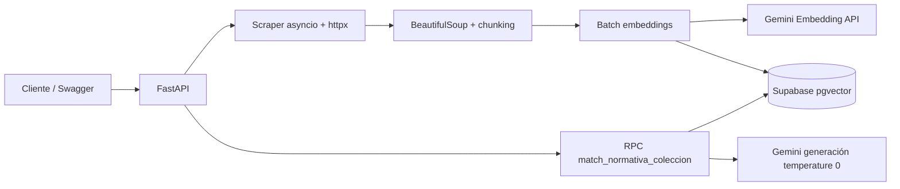
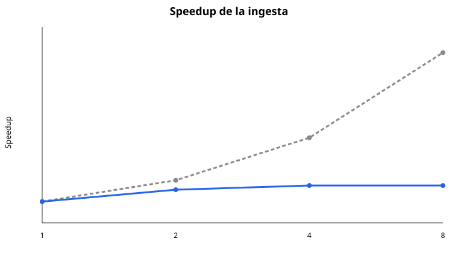
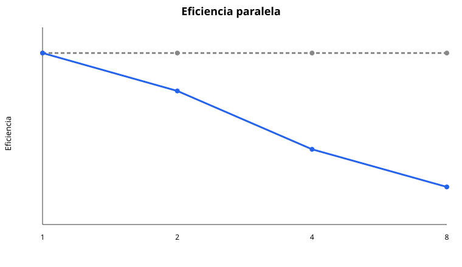
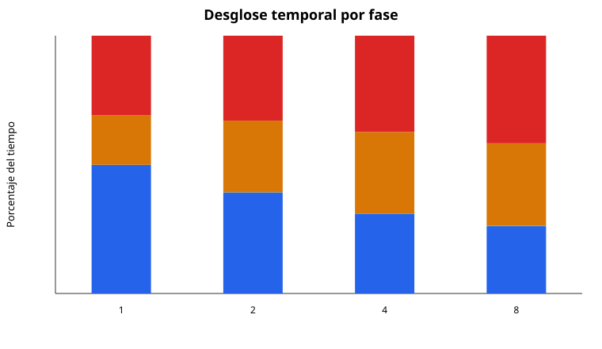

# Informe técnico: rendimiento y aislamiento

## 1. Arquitectura



## 2. Aislamiento multi-tenant

Cada fila contiene `coleccion_id`. La RPC aplica primero:

```sql
where n.coleccion_id = match_collection
```

y solo después ordena por distancia coseno. La prueba `tests/test_rpc_contract.py` verifica el contrato SQL. La demostración manual recomendada es insertar dos colecciones con contenido contradictorio y comprobar que cada consulta devuelve únicamente sus propias fuentes.

## 3. Experimento y metodología

Usa 10 URLs de tamaño similar, preferentemente del mismo portal y con contenido público estable. Ejecuta:

```bash
python3 scripts/benchmark.py --repetitions 3 URL_1 URL_2 URL_3 URL_4 URL_5 URL_6 URL_7 URL_8 URL_9 URL_10 > benchmark.json
```

El script ejecuta la ingesta completa con `p = 1, 2, 4, 8`. Para cada valor registra las repeticiones individuales y usa su mediana como `T_p`, reduciendo el efecto de variaciones transitorias de red y API. El JSON también conserva el desglose por fases, porcentajes y metadatos del experimento.

| Workers | T_p (s) | S_p = T_1/T_p | E_p = S_p/p |
|---:|---:|---:|---:|
| 1 | 7.2247 | 1.0000 | 1.0000 |
| 2 | 4.6380 | 1.5577 | 0.7789 |
| 4 | 4.1182 | 1.7543 | 0.4386 |
| 8 | 4.1208 | 1.7532 | 0.2192 |

La medición real se ejecutó el 2026-10-08 con 10 URLs públicas, una repetición por nivel, `chunk_size=5000`, `chunk_overlap=0` y `embedding_batch_size=100`. Los valores se obtuvieron de `benchmark.json`; no son estimaciones.

## 4. Fundamento teórico

La granularidad principal es una URL por tarea de scraping y una página válida por tarea de chunking. Esta granularidad es adecuada porque una descarga tiene latencia suficiente para ocultar el costo de planificar una tarea. En cambio, crear una tarea por fragmento pequeño aumentaría el overhead de scheduling, serialización y coordinación sin aportar suficiente trabajo útil.

El costo observado puede expresarse como:

$$T_p = T_{serial} + \frac{T_{paralelizable}}{p} + T_{overhead}(p)$$

Aquí `T_serial` incluye coordinación, llamadas externas que permanecen secuenciales e inserciones; `T_overhead(p)` incluye creación de tareas, sincronización, conexiones y variabilidad de servicios externos. El chunking usa `ThreadPoolExecutor`; como es procesamiento Python, los hilos reducen la espera entre tareas, pero no garantizan paralelismo de CPU debido al GIL. Por eso el resultado debe interpretarse como concurrencia del pipeline, no como aceleración CPU ideal.

La Ley de Amdahl establece el límite de aceleración para una fracción serial `s`:

$$S_p \leq \frac{1}{s + \frac{1-s}{p}}$$

La Ley de Gustafson analiza el escalamiento cuando el tamaño del problema crece con los recursos:

$$S_G(p) = p - s(p-1)$$

En este experimento el tamaño de entrada se mantiene fijo en 10 URLs, por lo que la métrica principal es Amdahl. Gustafson se reporta como análisis complementario: sería pertinente para evaluar cuántas URLs adicionales puede procesar el sistema en un tiempo similar al aumentar `p`.

## 5. Interpretación

La aceleración no tiene por qué ser lineal: scraping y llamadas externas están limitados por latencia, ancho de banda y cuotas de Gemini. Si el porcentaje de embeddings domina, la Ley de Amdahl explica que aumentar workers de scraping produce rendimientos decrecientes. Reporta también `desglose_porcentual` para scraping/red, chunking/CPU, API de embeddings e inserción Supabase.

Compara `S_p` con el ideal `p`. Una eficiencia inferior a `1` evidencia overhead o una fracción serial significativa. Si `T_p` deja de disminuir al aumentar `p`, la explicación debe buscarse en límites de conexión, rate limiting, capacidad de Supabase o saturación del portal, no únicamente en el número de hilos.

En la medición, pasar de 1 a 2 workers redujo el tiempo de 7.2247 s a 4.6380 s y produjo `S_2=1.5577`. Con 4 workers se alcanzó el mejor tiempo, 4.1182 s, con `S_4=1.7543`. Al aumentar a 8 workers el tiempo fue 4.1208 s, prácticamente igual al de 4 workers, mientras la eficiencia cayó a `E_8=0.2192`. Esto muestra rendimiento decreciente: el scraping mejora con más concurrencia, pero embeddings e inserción Supabase permanecen parcialmente seriales y dominan el tiempo restante.

El desglose confirma el cuello de botella. Con un worker, scraping/red representa 49.86% y las fases externas de embeddings e inserción suman 50.09%. Con 8 workers, scraping baja a 26.12%, pero embeddings e inserción suben a 73.73% del tiempo observado. Por ello, añadir workers de descarga no puede producir aceleración lineal frente a cuotas, latencia y capacidad de APIs de terceros.

### Gráficos







## 6. Prueba de cero contaminación

1. Crear `coleccion_a` con un documento que contenga una respuesta exclusiva.
2. Crear `coleccion_b` con un documento distinto y contradictorio.
3. Consultar la misma pregunta usando cada `coleccion_id`.
4. Verificar que las fuentes y la respuesta pertenecen solamente a la colección solicitada.
5. Consultar una colección inexistente y verificar el mensaje explícito de ausencia de antecedentes.

## 7. Limitaciones declaradas

El benchmark depende de servicios externos y sus cuotas. Para que sea reproducible, registra fecha, región, número de URLs, tamaño aproximado, modelo, `chunk_size`, `chunk_overlap`, versión del código y cualquier respuesta 429. No presentes datos inventados: completa las tablas con la salida real de `benchmark.json`.
