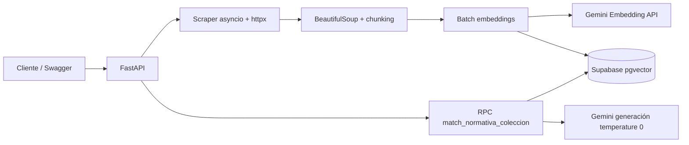

# Informe técnico: rendimiento y aislamiento

## 1. Arquitectura



## 2. Aislamiento multi-tenant

Cada fila contiene `coleccion_id`. La RPC aplica primero:

```sql
where n.coleccion_id = match_collection
```

y solo después ordena por distancia coseno. La prueba `tests/test_rpc_contract.py` verifica el contrato SQL. La demostración manual recomendada es insertar dos colecciones con contenido contradictorio y comprobar que cada consulta devuelve únicamente sus propias fuentes.

## 3. Experimento

Usa 10 URLs de tamaño similar, preferentemente del mismo portal y con contenido público estable. Ejecuta:

```bash
python3 scripts/benchmark.py URL_1 URL_2 URL_3 URL_4 URL_5 URL_6 URL_7 URL_8 URL_9 URL_10 > benchmark.json
```

El script ejecuta la ingesta completa con `p = 1, 2, 4, 8` y produce duración total, desglose por fases, speedup y eficiencia.

| Workers | T_p (s) | S_p = T_1/T_p | E_p = S_p/p |
|---:|---:|---:|---:|
| 1 | completar | 1.00 | 1.00 |
| 2 | completar | completar | completar |
| 4 | completar | completar | completar |
| 8 | completar | completar | completar |

## 4. Interpretación

La aceleración no tiene por qué ser lineal: scraping y llamadas externas están limitados por latencia, ancho de banda y cuotas de Gemini. Si el porcentaje de embeddings domina, la Ley de Amdahl explica que aumentar workers de scraping produce rendimientos decrecientes. Reporta también `desglose_porcentual` para scraping/red, chunking/CPU, API de embeddings e inserción Supabase.

## 5. Prueba de cero contaminación

1. Crear `coleccion_a` con un documento que contenga una respuesta exclusiva.
2. Crear `coleccion_b` con un documento distinto y contradictorio.
3. Consultar la misma pregunta usando cada `coleccion_id`.
4. Verificar que las fuentes y la respuesta pertenecen solamente a la colección solicitada.
5. Consultar una colección inexistente y verificar el mensaje explícito de ausencia de antecedentes.

## 6. Limitaciones declaradas

El benchmark depende de servicios externos y sus cuotas. Para que sea reproducible, registra fecha, región, número de URLs, tamaño aproximado, modelo, `chunk_size`, `chunk_overlap`, versión del código y cualquier respuesta 429. No presentes datos inventados: completa las tablas con la salida real de `benchmark.json`.
